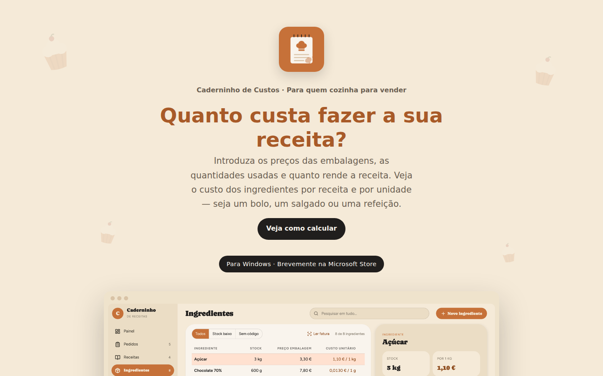
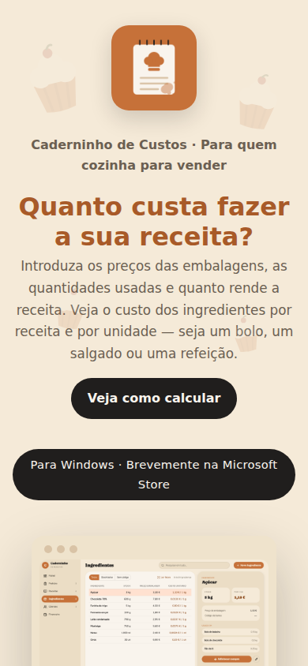
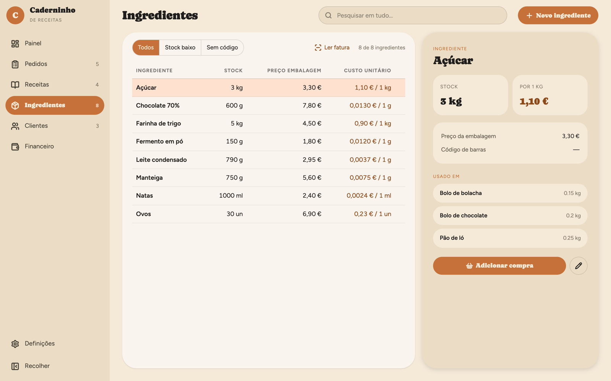
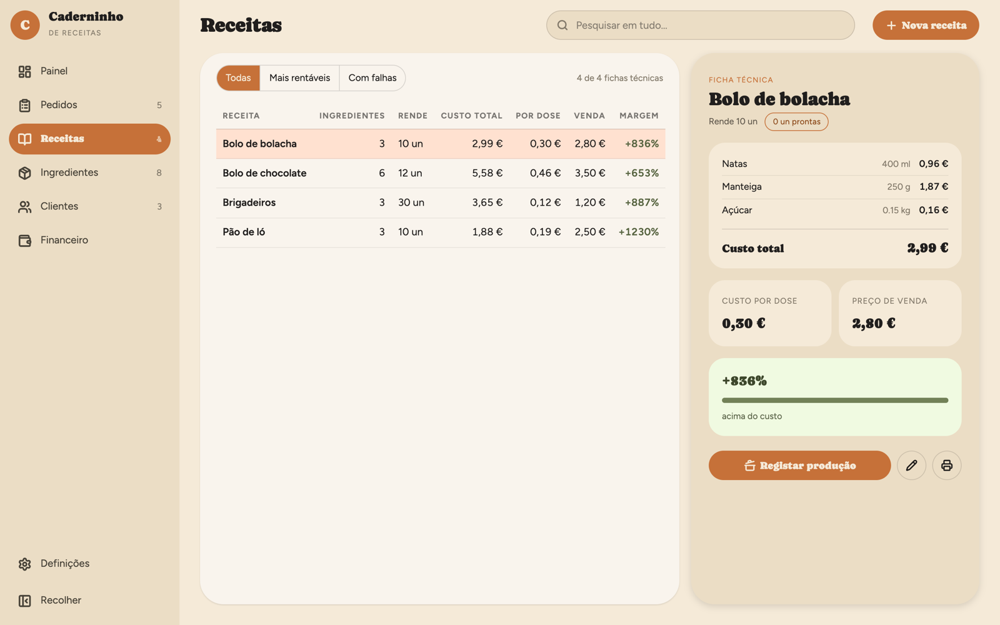
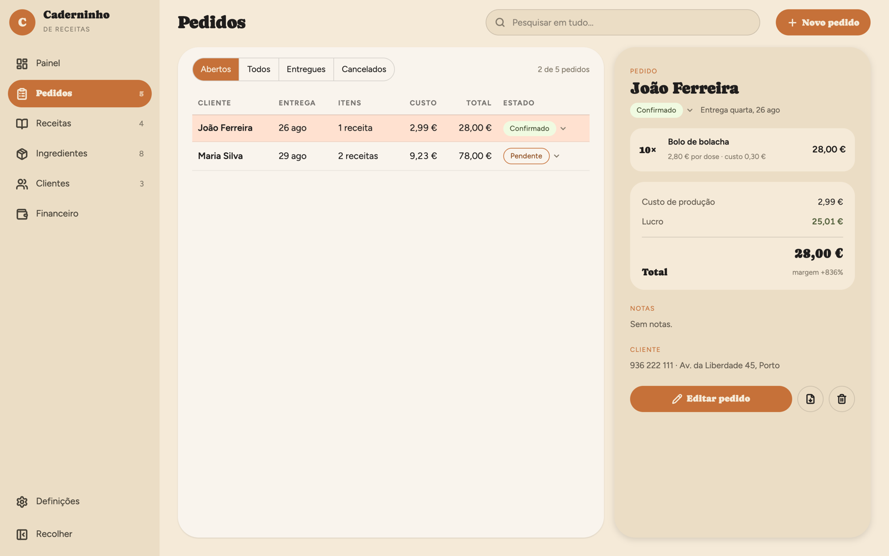
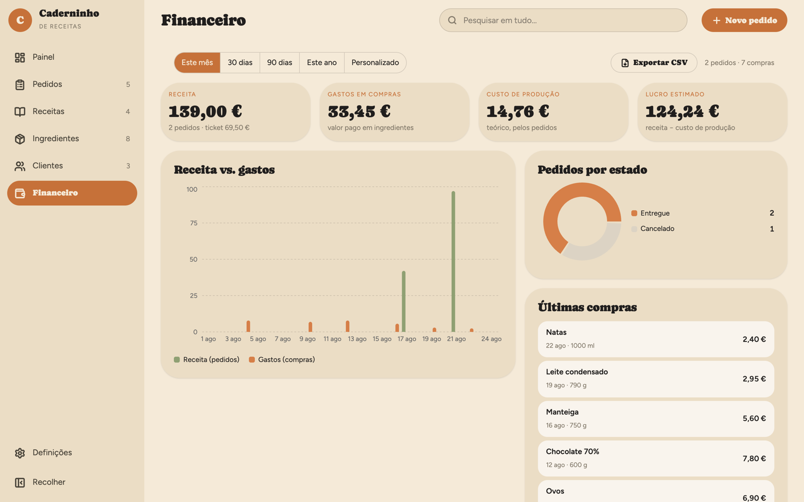
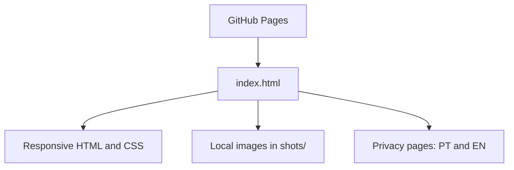

# Caderninho de Custos

**A product landing page for a Windows app that helps small food businesses understand ingredient costs before pricing a recipe.**

[Visit the live site](https://luisfelipealves.github.io/caderninho-site/) · [Privacy policy (PT)](privacidade.html) · [Privacy policy (EN)](privacy.html)



*Current landing page captured in an automated Chromium desktop viewport. Product screens further below are illustrative assets on the site.*



## What visitors can explore

The page explains the path from purchased ingredient packages to the cost of a recipe and the cost per serving. It also introduces recipe sheets, stock, orders and financial views, with concrete examples and privacy details. The site presents the desktop product; **this repository contains the landing page, not the Windows application's source code**.

| Ingredients | Recipes |
| --- | --- |
|  |  |
| Orders | Finances |
|  |  |

## Architecture



This is a static, dependency-free site: semantic HTML, inline CSS, local assets and no runtime backend. It includes responsive layouts, descriptive image alternatives, keyboard focus styles, reduced-motion handling and social sharing metadata. The privacy copy distinguishes data stored on the user's computer from optional external services described for the desktop app.

## Run locally

```bash
git clone https://github.com/luisfelipealves/caderninho-site.git
cd caderninho-site
python3 -m http.server 8000
```

Open `http://localhost:8000`. No package installation or build step is required. Deploy by serving the repository's root as a static site; GitHub Pages currently hosts the public version.

## How we built it

I defined the audience and product claims with an AI assistant, iterated on the copy and page layout, checked that screenshots matched the sections, and reviewed the responsive presentation and privacy language. The human owner made product and publication decisions; AI helped implement and refine the static page. This README documents the site repository only.

## Portfolio snapshot

**Role:** product direction, UX review and release decisions, with AI-assisted implementation. **Highlights:** static delivery, responsive UI, accessibility details, product storytelling and bilingual privacy pages.
